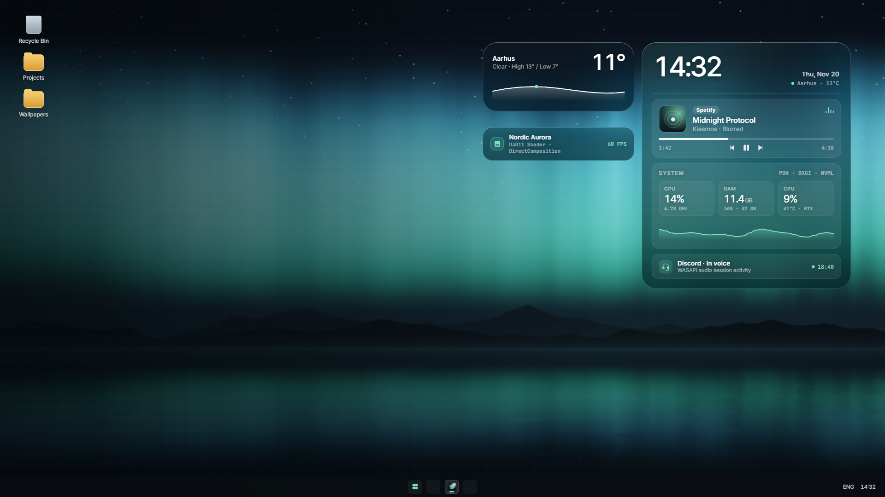
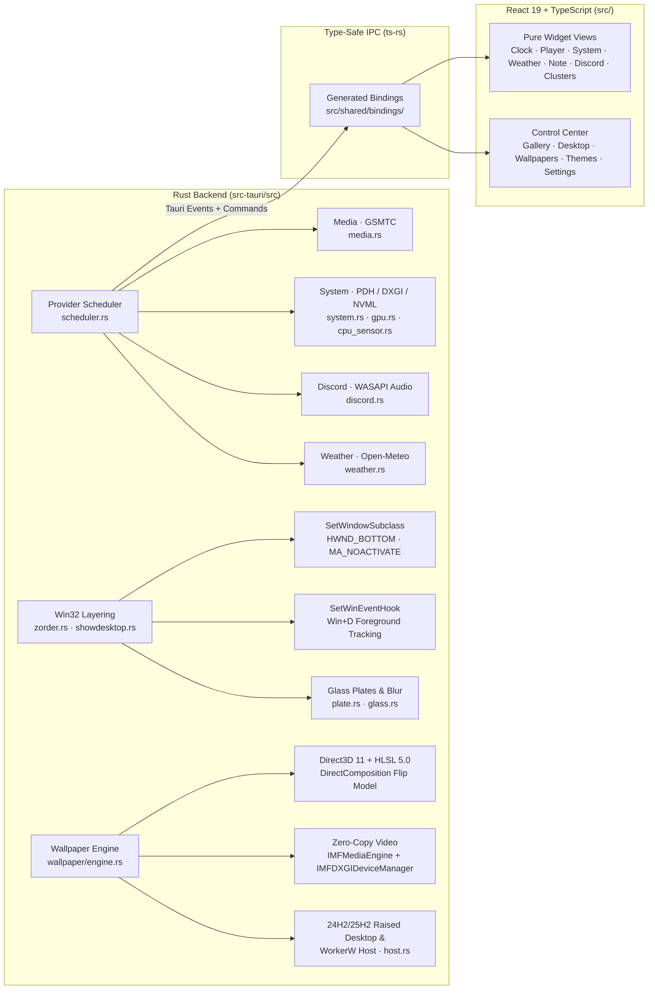

<div align="center">


# Open Dock

**Lightweight, Windows-native liquid-glass desktop dock & D3D11 wallpaper engine.**

Built with **Rust**, **Tauri v2**, **Win32 Subclassing**, and **Direct3D 11 + DirectComposition**.

[](LICENSE)
[](#prerequisites)

<br />



</div>

---

## Why Open Dock?

Most desktop widget tools rely on polling loops, heavy Electron processes, or WebView wallpaper windows that spin the GPU at desktop refresh rate. **Open Dock** takes a systems-first Windows approach:

- **~7.5 MB native release executable** (`6.45 MB` prior to the D3D11 wallpaper subsystem; `7.89 MB` / `7.53 MiB` measured with the full engine included) with no bundled Node runtime.
- **Push-based IPC — zero polling loops:** Providers are reference-counted per active widget window (`src-tauri/src/providers/scheduler.rs`) and emit Tauri events on OS changes or hardware cadence. Widgets animate in CSS without idle `requestAnimationFrame` loops.
- **Direct Win32 desktop integration:** Widgets anchor underneath normal application windows on the desktop layer (`HWND_BOTTOM`), never steal focus (`MA_NOACTIVATE`), survive Explorer restarts (`TaskbarCreated`), and respond properly to `Win+D` Show Desktop.
- **Zero telemetry, zero accounts:** Only two explicit outbound Rust network clients exist — [Open-Meteo](https://open-meteo.com/) for local weather forecasts and on-demand caching of user-selected curated 4K Unsplash photographs.

---

## Architecture Overview



### 1. Win32 Subclassing & Desktop Layering

Native window behavior lives in [`src-tauri/src/desktop/`](src-tauri/src/desktop/mod.rs):

- **Z-order & Non-Activating Focus (`zorder.rs`, `styles.rs`):** Every widget `HWND` is subclassed via `SetWindowSubclass`. In `widget_proc`:
  - `WM_WINDOWPOSCHANGING` intercepts z-order changes when `Layer::Desktop` is active (and Show Desktop is inactive) and rewrites `WINDOWPOS.hwndInsertAfter = HWND_BOTTOM`, keeping widgets below open windows like oversized desktop icons.
  - `WM_MOUSEACTIVATE` returns `MA_NOACTIVATE` unless an editable control (such as the Note widget) explicitly requests activation, preventing accidental focus stealing from games, terminals, or editors.
  - `WM_NCDESTROY` detaches the subclass cleanly and frees the `Arc<HwndState>` state pointer.
- **`Win+D` Show Desktop Recovery (`showdesktop.rs`):** Registers an out-of-context `SetWinEventHook(EVENT_SYSTEM_FOREGROUND)` watching for `Progman` / `WorkerW` (`SHELLDLL_DefView`) rising to the front of the top-level window stack, temporarily lifting `Layer::Desktop` widgets into `HWND_TOPMOST` so `Win+D` behaves like native desktop gadgets, then restoring `HWND_BOTTOM` as soon as an app window takes foreground.
- **Explorer Restart, DPI & Wallpaper Hooks (`desktop/mod.rs`):** Subclasses the control window to listen for the registered `TaskbarCreated` message, `WM_SETTINGCHANGE` (`SPI_SETDESKWALLPAPER`), `WM_DISPLAYCHANGE`, and `WM_DPICHANGED`, reapplying z-order, refreshing wallpaper glass plates, and notifying the wallpaper engine across multi-monitor setups with mixed DPI scaling.

### 2. Push-Based Provider Scheduler & Hardware Telemetry

All system, media, voice, and weather feeds flow through [`src-tauri/src/providers/scheduler.rs`](src-tauri/src/providers/scheduler.rs):

- **Reference-counted subscriptions:** Providers only run while at least one visible widget or Control Center preview subscribes to their `(ProviderKind, key)` pair, and stop cleanly on pause (`fullscreen`, `battery`, or manual pause) or unsubscribe.
- **Media (`media.rs`):** Native Windows **GSMTC** (`Media_Control`) reader supporting simultaneous sources (Spotify, browsers, VLC), AUMID-to-app resolution via `FOLDERID_AppsFolder`, album art disk caching, ambient color extraction, and transport/seek controls.
- **System (`system.rs`, `gpu.rs`, `cpu_sensor.rs`):** Native PDH `\Processor Information(*)\% Processor Time` and `% Processor Performance` frequency counters paired with DXGI LUID-matched `\GPU Engine` / `GPU Adapter Memory` and optional `nvml-wrapper` NVIDIA metrics. Supports optional elevated helper (`OpenDock.CpuSensors.exe` compiled cleanly in `build.rs` against SHA-256-pinned LibreHardwareMonitor DLLs) for ring-0 CPU package temperature when PawnIO is installed.
- **Discord (`discord.rs`):** Passive process + WASAPI capture/render audio session heuristic (`CallDetector` with 2-sample onset / 3-sample release debounce) — no Discord OAuth token or account login required.
- **Weather (`weather.rs`):** Open-Meteo geocoding and forecasts fetched strictly in Rust with offline disk cache and stale indicators.

### 3. Frosted Glass Engine & Wallpaper Plate Sampling

[`src-tauri/src/desktop/plate.rs`](src-tauri/src/desktop/plate.rs) and [`glass.rs`](src-tauri/src/desktop/glass.rs) support three engines:

- **Wallpaper Engine (`GlassEngine::Wallpaper`):** Pre-renders blurred per-monitor glass plates (including live poster overrides when an animated shader or video scene is running) paired with a spatial `LumaGrid` for automatic legibility across bright and dark desktop regions.
- **Windows 11 Acrylic (`GlassEngine::Acrylic`):** Uses native DWM acrylic vibrancy (`DWMWCP_ROUND`) on Windows 11.
- **Simple Tint (`GlassEngine::Tint`):** Lightweight solid/translucent fallback without blur overhead.

### 4. Native D3D11 & DirectComposition Wallpaper Engine

[`src-tauri/src/wallpaper/`](src-tauri/src/wallpaper/mod.rs) powers both animated desktop scenes and lossless static backgrounds without extra Chromium/WebView2 processes:

- **Dual Desktop Host Topology (`host.rs`):** Sends `0x052C` to `Progman` and detects both **Windows 11 24H2/25H2 Raised Desktop** (`Progman` with `WS_EX_NOREDIRECTIONBITMAP`, parenting a layered child HWND below `SHELLDLL_DefView`) and classic **`WorkerW`** via `SetParent` + `ScreenToClient`.
- **Direct3D 11 + DirectComposition (`engine.rs`, `shader_compiler.rs`):** Matches an `ID3D11Device` per monitor DXGI adapter LUID, drives 8 compiled HLSL 5.0 pixel shaders (`D3DCompile`, ACES filmic tonemapping, triangular-PDF sub-LSB dithering against 8-bit dark banding) via `IDXGISwapChain1` (`DXGI_SWAP_EFFECT_FLIP_DISCARD`) and `DCompositionCreateDevice`, paced by `CREATE_WAITABLE_TIMER_HIGH_RESOLUTION`.
- **Zero-Copy Hardware Video (`video.rs`):** Decodes `.mp4` / `.webm` / `.mkv` / `.mov` / `.wmv` via Media Foundation `IMFMediaEngine` + `IMFDXGIDeviceManager` (`TransferVideoFrame` directly into the swap chain texture on `OnVideoStreamTick`).
- **Occlusion Culling & Lossless Static Tweak (`occlusion.rs`, `quality.rs`, `static_apply.rs`):** Automatically throttles to **0% GPU** when a monitor is covered by maximized/fullscreen windows (`DWMWA_EXTENDED_FRAME_BOUNDS` + `IsZoomed`) or workstation lock (`OpenInputDesktop`). Static images use Lanczos3 resampling + lossless PNG via `IDesktopWallpaper`, plus an optional toggle for Windows' `HKCU\Control Panel\Desktop\JPEGImportQuality = 100` registry setting.

---

## Widgets & Features

- **Freeform Widgets:** `Clock`, `Player` (GSMTC with multi-source chips), `System` (CPU/RAM/GPU/VRAM/Net/Disk + 60-point sparkline), `Weather` (hourly/7-day curve), `Note` (checklists/notes), and `Discord` (voice activity).
- **Adaptive Clusters (`All-in-One Box`, `Mini Trio`, `Capsule Bar`, Custom):** Compact multi-module docks (`232` / `264` / `288u`) that dynamically expand on active playback, system load, or click using synchronized two-phase Win32 window sizing.
- **Themes & Control Center:** **Aurora** (frosted light glass), **Lærk** (warm ceramic stone glass), and **Grafit** (smoked obsidian + `#7FE3C1` mint), configured in a Dark/Light Control Center (`Gallery`, `Desktop`, `Wallpapers`, `Themes`, `Settings`) with dot-grid drag snapping (~120 Hz Rust drag loop) and JSON layout import/export.

---

## Prerequisites & Build From Source

- **Windows 10 / Windows 11 (x64)**
- **Node.js 24+** (`npm`)
- **Rust 1.95+** (`x86_64-pc-windows-msvc`) + Visual Studio C++ Build Tools / Windows SDK

```powershell
# 1. Install frontend dependencies
npm install

# 2. Run in development mode (Vite + Tauri)
npm run dev:tauri

# 3. Build production executable & NSIS installer
npm run build:tauri
```

### Verification Commands

```powershell
# Regenerate TypeScript IPC types from Rust (ts-rs)
npm run bindings

# Frontend checks
npx tsc --noEmit
npm run lint
npm test

# Rust unit tests & Clippy
cargo test --manifest-path src-tauri/Cargo.toml
cargo clippy --manifest-path src-tauri/Cargo.toml -- -D warnings
```

---

## Keyboard Shortcuts

| Context | Shortcut | Action |
|---|---|---|
| Global | `Ctrl+Alt+E` | Toggle layout edit mode |
| Global | `Ctrl+Alt+H` | Show / hide all widgets |
| Edit mode | Drag / Hold `Alt` | Move widget (hold `Alt` to bypass snap guides) |
| Edit mode | Arrow keys / `Shift`+Arrow | Nudge widget position (`1 px` / `8 px`) |
| Edit mode | `Delete` / `Escape` | Remove selected widget / Exit edit mode |
| Control Center | `Ctrl+1` .. `Ctrl+5` | Switch between Gallery, Desktop, Wallpapers, Themes, Settings |

---

## Roadmap & Contributions

See [ROADMAP.md](ROADMAP.md) for upcoming work, including **agent/developer status feeds** (Devin / CI / PR event streams integrated into adaptive clusters) and ongoing Win32 subclassing hardening across multi-GPU, virtual-desktop, and third-party shell configurations.

Contributions are welcome — see [CONTRIBUTING.md](CONTRIBUTING.md) and [SECURITY.md](SECURITY.md).

---

## License

Licensed under the **MIT License** — see [LICENSE](LICENSE).

Third-party upstream sensor dependencies bundled in [`src-tauri/resources/cpu-sensor/`](src-tauri/resources/cpu-sensor/licenses/SOURCES.txt) retain their respective licenses (`MPL-2.0`, `LGPL-2.1`, `Apache-2.0`, `MIT`) and are verified at compile time via pinned SHA-256 digests in [`libraries.json`](src-tauri/resources/cpu-sensor/libraries.json).
